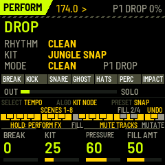
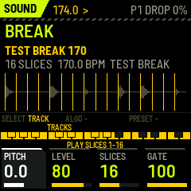
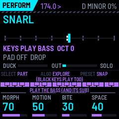

<h1 align="center">JUNGLE OS</h1>

<p align="center">
  <b>Two firmwares for the M-VAVE FM-1 that make a drum &amp; bass live rig</b><br>
  BREAK SURGEON plays the breaks and drums, ABYSS ENGINE the neuro bass, sub, stabs and pads; each works alone, and
  together they share clock, scenes, fills and kicks over JUNGLE LINK.
</p>

<p align="center">
  <a href="https://rahelpuest.github.io/jungle-os-fm1/break-surgeon/emu/"><b>▶ Break Surgeon in your browser</b></a> ·
  <a href="https://rahelpuest.github.io/jungle-os-fm1/abyss-engine/emu/"><b>▶ Abyss Engine in your browser</b></a><br>
  <a href="https://rahelpuest.github.io/jungle-os-fm1/">Site</a> ·
  Manuals: <a href="https://rahelpuest.github.io/jungle-os-fm1/break-surgeon/manual/">Break Surgeon</a>, <a href="https://rahelpuest.github.io/jungle-os-fm1/abyss-engine/manual/">Abyss Engine</a> ·
  <a href="https://rahelpuest.github.io/jungle-os-fm1/live/">Live set</a> ·
  <a href="https://github.com/RahelPuest/jungle-os-fm1/releases">Releases</a>
</p>

<p align="center">
  
  
  
</p>

<p align="center">
  
  
  
</p>

> [!WARNING]
> Neither firmware has been installed on a physical FM-1 yet. They are tested in software: engine tests, audio
> renders, fm1-base's host simulator, the browser emulator, and fm1-emu, which executes the real device binaries.
> Installing is at your own risk; the web installer can put M-VAVE's own firmware back, and
> [docs/development/install-and-recovery.md](docs/development/install-and-recovery.md) describes the recovery routes.

## What it is

Two custom firmwares for two M-VAVE FM-1s that together make a hardware drum & bass / jungle / neurofunk live rig:

- **BREAK SURGEON** — a sliced-break player and six synthesized drum models (PUNCH KICK, CRACK SNARE, GHOST
  SNARE, METAL HATS, BREAK PERC, IMPACT FX) on one sample-accurate step sequencer, with performance modes (ROLL,
  CHOP, REVERSE, GLITCH, DESTROY, FREEZE), fills, ghost generation, mutation with anchors and undo, BREAK-LOCK,
  rhythm and kit sweetspot graphs, six scenes, and the DRUM PRESSURE master bus.
- **ABYSS ENGINE** — a neuro bass (FM CREATURE, REESE MATRIX) navigated through a curated sweetspot graph (MORPH,
  SNAP, EXPLORE, MUTATE, UNDO), a separate clean mono sub, rave/orchestral/glass/dark stabs, an evolving pad, a
  harmonic sequencer on a shared key, ducking from Break Surgeon's kicks, and the bass-safe NEURO PRESSURE master.

They talk **JUNGLE LINK** (plain MIDI: clock, transport, scenes, fills, kick triggers) and each works alone.

## Status: 0.3.0 — simulator-tested, not yet on hardware

| | |
|---|---|
| Builds for the FM-1 | yes: `breaksurgeon.fwsc` (154 KB image), `abyssengine.fwsc` (151 KB), all fm1-base static checks pass |
| Tested | 124 engine checks, 8 audio-regression renders, the sample tools, both whole apps scripted in fm1-base's host simulator, both device binaries booted and played in fm1-emu |
| CPU (fm1-emu, 240 MHz, lower bound) | Break Surgeon 17 % playing (0.2, with the room), Abyss Engine 28–38 % |
| **Not done** | **no install on a physical FM-1 yet**; real CPU load; two-FM-1 link; listening certification of the sweetspots |

What is real and what is not, feature by feature: [docs/research/compatibility-matrix.md](docs/research/compatibility-matrix.md).

Hardware facts that shaped it ([docs/research/hardware.md](docs/research/hardware.md)): the FM-1 has **no audio
input** (breaks are prepared offline and loaded over USB), **no MIDI out jack** (TRS is input only; MIDI out is
USB), 14 buttons, 7 encoders without push, 27 keys, 512 KiB RAM, 1 MiB flash, 44,117.6 Hz.

## Quick start (no FM-1 needed)

```sh
git clone --recursive https://github.com/RahelPuest/jungle-os-fm1 jungle_os && cd jungle_os
make -C tests && make -C tests renders          # engine tests; WAV renders in tests/build/renders
tools/build_all.sh --no-device                  # + both host simulators and their scripted runs
```

The site (both browser emulators, manuals, web installers, the release packages in `release/`):
`tools/make_site.sh 0.3.0` writes `release/site`, which `.github/workflows/pages.yml` deploys on a push to main.

Device packages need the JieLi toolchain, the AC79 SDK and Docker: [docs/development/setup.md](docs/development/setup.md).
Installing on an FM-1: [docs/development/install-and-recovery.md](docs/development/install-and-recovery.md) —
read it first; nothing has been flashed to a device yet.

Your own breaks: `python3 tools/sample-prep/jo_sample_prep.py build my.bank break.wav:2:16 --snap`, then
`python3 tools/sample-prep/jo_send_bank.py my.bank` ([docs/development/sample-format.md](docs/development/sample-format.md)).

## Documentation

| | |
|---|---|
| [Manual: Break Surgeon](firmware/break-surgeon/docs/MANUAL.md) ([on the site](https://rahelpuest.github.io/jungle-os-fm1/break-surgeon/manual/)) | every control, every page |
| [Manual: Abyss Engine](firmware/abyss-engine/docs/MANUAL.md) ([on the site](https://rahelpuest.github.io/jungle-os-fm1/abyss-engine/manual/)) | |
| [Live performance](docs/user-guide/live-performance.md) | a 20-minute set, transitions, gain staging |
| [Architecture](docs/architecture/overview.md) | layers, threads, audio graphs, voices, flash map, budgets |
| [JUNGLE LINK](docs/architecture/link-protocol.md) · [control maps](docs/architecture/control-maps.md) | |
| [Research: hardware](docs/research/hardware.md) · [upstream audit](docs/research/upstream-audit.md) · [feasibility](docs/research/compatibility-matrix.md) | |
| [Development](docs/development/) | setup, testing, sample format, sweetspots, profiling, install |

## Built on

[fm1-base](https://github.com/charlesvestal/fm1-base) by Charles Vestal and
[felucca-bsp](https://github.com/hugelton/felucca-bsp) by Leo Kuroshita (Hügelton Instruments), MPL-2.0, as a
submodule, unmodified. Everything else is original. GPL firmwares (SLOOP, X0X, Felucca, PIGEON) were studied for
facts and ideas only; no code was copied ([THIRD_PARTY_NOTICES.md](THIRD_PARTY_NOTICES.md)).

JUNGLE OS is **MPL-2.0** ([LICENSE](LICENSE)). It is not affiliated with M-VAVE; M-VAVE and FM-1 are trademarks of
their owners. The repository contains no third-party audio: the test break is generated.
