# The ABYSS ENGINE manual

ABYSS ENGINE is a bass sequencer: a neuro bass (FM CREATURE, REESE MATRIX) through a curated graph of sweetspot
sounds, a separate clean sub, stabs and an evolving pad, on three tracks of steps in a shared key. The live tools
(performance FX, fills, variations, scenes) sit on buttons you hold. Status: it runs in the simulators and the browser
emulator; **it has not been tested on an FM-1 yet**.

## The one rule

**Tap a button: a page. Hold a button: a layer, while you hold it. Let go: back, always safe.**

On every page the 16 white keys are the 16 steps of the selected track, and black keys 1–3 pick the track: BASS,
STAB, PAD. The screen's strip shows, at all times, what the encoders and every run of keys do, and names the held
layer.

## Quick start

1. **PLAY.** Pattern 1 plays: a bass line in D minor at 174 BPM.
2. **Tap a white key:** a step on or off. **Hold it and turn K1:** its note.
3. **ALGO:** the library: a new bass line (ROLLING, OFFBEAT, NEURO STABS, HALF-TIME, REESE LONG, TWO-STEP, ACID,
   WOBBLE 8THS), in the key. On STAB and PAD, chord rhythms. SEL + LFO undoes it.
4. **K1 CHAR** moves the bass through its sounds (HOLLOW to BROKEN). K2 MOTION, K3 BITE, K4 GLIDE.
5. **Hold FX and a white key:** a performance FX while you hold (OCT UP, FILTER DIVE, TAPE STOP …).
6. **Tap ENV:** a fill in the last bar of the phrase. **Hold ENV + white 1–4:** a fill from the next bar.
7. **Hold LFO + white 9 to 14:** a FORM: the bass answers itself, A B A C.
8. **Tap REC** and play the keys: they are recorded into the track. Tap REC again to stop.
9. **Hold HOME** and turn K1: ENERGY, the whole bass from its skeleton to everything. **Hold SEQ:** DUET, where the
   machine answers what you play and keeps the bass out of Break Surgeon's kicks.

The same buttons do the same on BREAK SURGEON.

## The screen

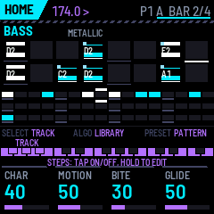

- **The header:** the page (or the held layer, or REC in red), the tempo (LINK: following Break Surgeon), the
  pattern and the variation playing (P1 A), and the bar of the phrase (BAR 2/4). A bar along its bottom fills up
  while a pattern or a scene waits to land.
- **The page.** HOME shows the selected track's 16 steps big: a lit box is a step, its bar the velocity; on BASS
  the note is written in it. Marks: a red corner = a trig condition, a blue one = a lock, a grey dot = a probability,
  a white line = slide. Below, every track as a mini row.
- **The strip:** what SELECT, ALGO and PRESET do, and what each run of keys does.
- **The four knob boxes.**

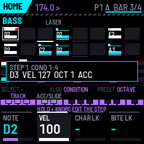

## Steps and tracks (every page)

| Control | Does |
|---|---|
| white key, tap | the step on / off |
| white key, hold | edit the step: a popup shows its values |
| hold + K1 / K2 / K3 / K4 | NOTE (BASS: scale steps; STAB, PAD: the chord degree) / VELOCITY / a CHARACTER lock / a BITE lock |
| hold + ALGO | the TRIG CONDITION: ALWAYS, 1:2, 2:2, 1:4, 2:4, 3:4, 4:4, FILL, NO FILL, PHRASE 1ST, PHRASE END |
| hold + PRESET | the step's octave (−2 … +2) |
| hold + black 4 / 5 | ACCENT / SLIDE (legato into the note) |
| black 1–3, SELECT | the track: BASS, STAB, PAD |
| ALGO | the library (above) |
| PRESET | the pattern P1–P4, at the next bar (or the phrase's end, QUANT = PHRASE) |
| OCT− / OCT+ | steps 1–16 / 17–32 of a longer track |

Trig conditions count bars on the global grid, so a 1:4 step lands in the same bar on both FM-1s. FILL steps play
only under a fill: put a few extra notes there and every fill brings them.

## The buttons

| Button | Tap | Hold: the layer |
|---|---|---|
| HOME | HOME (the steps) | **ENERGY** (0.6): SELECT or K1 = ENERGY, white = a step's level 1–4, K2 = the CURVE, K3 = AUTO LEVELS |
| SEQ | SEQUENCE: the three tracks, lengths, mutes | **DUET** (0.6): K1 ANSWER ME, K2 its transform, K3 POCKET, K4 GESTURE ECHO |
| EDIT | SOUND: the track's sound in depth; the keys play it | — |
| FX | FX: NEURO PRESSURE | **FX:** white 1–8 = OCT UP, OCT DOWN, FILTER DIVE, WOBBLE, STUTTER, TAPE STOP, BITE MAX, SUB ONLY, while held. K1–K4: WEIGHT, DIRT, WIDTH, PRESSURE |
| ARP | SONG: form, phrase, link helpers | **SONG:** white 1–8 = queue scene 1–8, white 9–12 = queue P1–P4, black 1–3 = mute / unmute BASS, STAB, PAD |
| GLO | SYSTEM | — |
| ENV | a fill in the phrase's last bar | **FILL:** white 1–4 = ROLLS, OCTAVES, DROP OUT, SLIDE DOWN from the next bar; K1 = 1 or 2 bars |
| LFO | MUTATE the bass sound | **VARY:** white 1–4 = variation A–D from the next bar; white 9–14 = FORM OFF, A B A C, A A A B, A B A B, A B C D, A A B B; ALGO = the variation's LINE; K1 DENSITY, K2 HUMANIZE, K3 MUTATE amount, K4 the variation's SOUND |
| REC | RECORD on / off | **ERASE:** white = clear the step, black 1–3 = clear the track |
| SAVE | save | **STORE:** white 1–8 = store the state as scene 1–8 |
| SEL | — | **SEL:** SEL + LFO = UNDO, SEL + ENV = REDO, SEL + PLAY = PANIC, SEL + REC = RETURN (SNAP, back to the scene), SEL + SELECT = tempo, SEL + knob = fine |
| PLAY | start / stop | |

A hold is a hold after you use it, or after 1.5 s; a short press without anything else is a tap.

### FX: performance FX

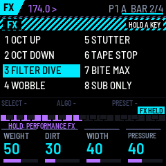

Each FX plays while its key is down and ends when you let go. OCT UP / OCT DOWN move the bass an octave. FILTER DIVE
closes the bass's low-pass five octaves over a bar. WOBBLE turns the bass's LFO to full at 1/8. STUTTER repeats the
note under it in 32nds. TAPE STOP slows the bass and sub two octaves down to silence over 0.6 s. BITE MAX is BITE
at full. SUB ONLY mutes the mid bass and leaves the sub.

### SONG and STORE: scenes, patterns, mutes

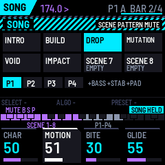

A scene holds the pattern, the mutes, PAD HOLD, the bass's CHARACTER / MOTION / BITE and SPACE, NEURO PRESSURE, the
root and the scale. Hold SAVE and press white 1–8 to store one.

### FILL

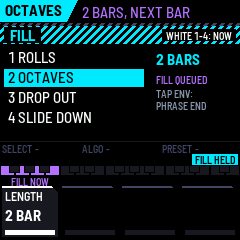

ROLLS: the bass rolls in the bar's second half, with octave jumps. OCTAVES: every second 8th an octave up. DROP OUT:
the bass and sub silent. SLIDE DOWN: every note slides down the scale. A tap of ENV plays the last chosen fill in the
phrase's last bar (or bars, at 2 bars).

### VARY: variations and the FORM

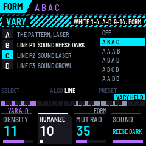

The bass has four variations. **A** is the bass as it is: the pattern's line and the knobs' sound. **B, C, D**
answer it, each with a **LINE** (A's, or the bass line of P1–P4) and a **SOUND** (A's, or one of the ten sweetspots,
REESE and REESE DARK included). Defaults: B = A's line as REESE, C = P2's line as LASER, D = P3's line as GROWL.

The **FORM** plays them bar by bar on the 4-bar grid: A B A C is the call and two answers (0.4's CALL &
RESPONSE), A A A B a switch-up in the fourth bar, A B A B, A B C D, A A B B. FORM OFF plays the variation you picked
last (white 1–4). Each part takes its sound from its first note on; the sub plays every part's notes.

DENSITY makes the selected track denser or emptier one step a click (the offbeat 16ths come and go first, the
downbeat last). HUMANIZE adds small fixed velocity and timing offsets as it plays. Both are undone like any edit.

### REC and ERASE

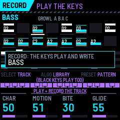

With REC on, the keys play the selected track and write each note into its nearest step: BASS the note, STAB and PAD
the nearest chord degree, with the velocity. OCT− / OCT+ then move the keyboard. A whole record pass is one UNDO.
Hold REC to erase steps or a track.

### ENERGY (hold HOME)

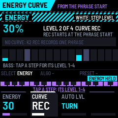

Every step has an ENERGY level, 1 to 4. ENERGY decides which play: at 0–25 % only level 1, at 75–100 % all four.
Level 1 is the skeleton (the downbeat, the bar's middle), 2 the other notes, 3 the soft ones, 4 the offbeat 16ths
and ratchets. The library's lines and the patterns come with levels; **K3 AUTO LEVELS** sets them again for the
selected track from the notes' roles, and a **white key** steps that step's level 1 → 2 → 3 → 4. Lower ENERGY also
takes some BITE out of the bass and darkens the pad; at 100 % it sounds as before.

- **SELECT or K1:** ENERGY. The header shows it as a thin bar (white while a curve plays).
- **K2 CURVE:** REC records one phrase of the knob from the next phrase's start, then plays it every phrase (a
  build-up as one movement); OFF goes back to the knob.
- **Over the link:** ENERGY goes both ways (CC 109). Turn it on either FM-1 and the other follows.

### DUET (hold SEQ): you and the machine

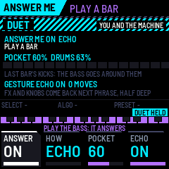

- **ANSWER ME (K1, K2):** with it on, the keys play the bass live, and the bass line's own steps rest. After every
  bar you played, the next bar the machine answers with your notes transformed (K2): **ECHO** (as you played),
  **INVERT** (mirrored around the root, in the scale), **RETRO** (backwards), **DISPLACE** (an 8th late), **OCT DOWN**,
  **SPARSE** (every second note). The answer sounds in variation C's sound. A bar you leave silent gets no answer;
  notes you play over the answer are not answered.
- **POCKET (K3):** with Break Surgeon linked, Abyss hears its kicks (the link's kick triggers) and moves every bass
  note that would fall on one of last bar's kicks to the next gap. Break Surgeon also sends how busy its drums were
  (DENSITY, CC 112): busy drums thin the bass towards its downbeat, sparse drums let it fill in; K3 is how much.
  Without the link it shows NO LINK and does nothing.
- **GESTURE ECHO (K4):** the performance FX you hold and the bass knobs you turn in one phrase come back in the next,
  half as deep (an FX half as long, a knob half the way).

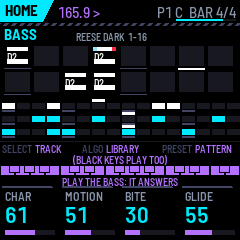

### TAPE DECAY (SONG page, OCT+)

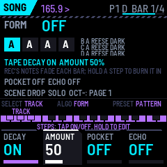

On SONG, OCT+ turns to the second knob page: K1 DECAY on / off, K2 AMOUNT, K3 POCKET, K4 GESTURE ECHO (OCT−: back).
With DECAY on, every note REC records fades a little each bar and goes after some bars (the more AMOUNT, the
sooner): a pattern you keep alive by playing. **Hold a step half a second** (no knob turned) to burn it in: it
stays, marked with a solid corner; a fading step has a thin one.

## The pages

### SEQUENCE (SEQ)

All three tracks with their LEN and SPEED, MUTED in red. K1 LENGTH (1–32), K2 SWING, K3 SPEED (1/16, 1/32, 1/8),
K4 SPACE (the delay / reverb send of stabs and pad).

### SOUND (EDIT)

The keys play the track here without recording. ALGO: the chord type (BASS, PAD) or the stab model (STAB). PRESET:
the root; SEL + PRESET: the scale.

| Track | K1 | K2 | K3 | K4 |
|---|---|---|---|---|
| BASS | MOD SHAPE | SUB SAT | SUB OCT (−1 / 0) | TENSION |
| STAB | SPACE | TENSION | INVERSION | — |
| PAD | SPACE | TENSION | ATTACK | RELEASE |

On HOME the knobs are each track's four main controls: BASS CHAR (the sweetspot path), MOTION, BITE, GLIDE; STAB
CHORD, ATTACK, BITE, TAIL; PAD DARKNESS, EVOLVE, TENSION, DEPTH.

### FX (NEURO PRESSURE)

K1 WEIGHT (the sub's level), K2 DIRT (the drive above 115 Hz), K3 WIDTH (pads and stabs above 140 Hz, never the
sub), K4 PRESSURE (glue and density with a compensating trim). PRESET: the output trim.

### SONG (ARP)

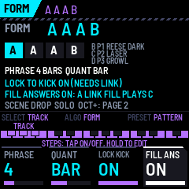

ALGO: the FORM. K1 PHRASE (4, 8, 16 bars: the header's BAR count, the fills' and PHRASE END's grid). K2 QUANT: when
scenes land (NOW, BEAT, BAR, 2 BAR, 4 BAR, PHRASE; PHRASE also lands patterns and variations at the phrase's end).
K3 **LOCK TO KICK**: with Break Surgeon linked, the bass plays on its kicks, the line giving the notes. K4 **FILL
ANSWERS**: a fill from Break Surgeon makes its bars play variation C. OCT+: the second knob page (TAPE DECAY above).

### SYSTEM (GLO)

K1 BPM, K2 VOICES (FULL, NO PAD, BASS ONLY, to drop parts under load), K3 LINK CH, K4 FOLLOW (LINK: the link's
clock, transport, scenes and fills). SELECT: DUCK (how deep Break Surgeon's kicks duck the sub); ALGO: SOLO DUCK
(duck on every beat when no link is heard); PRESET: the USB port as a host (unverified with another FM-1). The page
shows the load, the link, the store, the USB mode and how many sweetspots are still unreviewed: none is certified by
listening yet ([docs/development/sweetspots.md](https://github.com/RahelPuest/jungle-os-fm1/blob/main/docs/development/sweetspots.md)).

## Saving

SAVE saves the settings, the four patterns and the scenes (not while playing: a flash write stalls the sound). It
also happens by itself 3 s after STOP when something changed. ENERGY, ANSWER ME's transform, POCKET, GESTURE ECHO
and TAPE DECAY are saved with the settings (ANSWER ME itself starts off). 0.6 changed the stored formats again:
settings and patterns saved by 0.5 load as the defaults once; scenes are kept.
