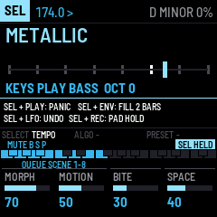
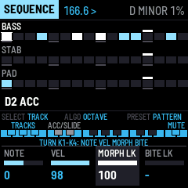
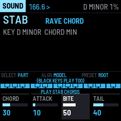
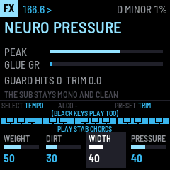
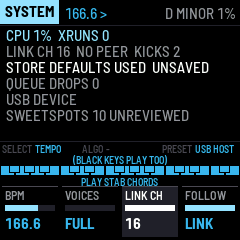

# The ABYSS ENGINE manual

ABYSS ENGINE is a neuro bass (FM CREATURE, REESE MATRIX) played through a curated graph of sweetspot sounds, with a
separate clean sub, stabs, an evolving pad, a harmonic sequencer on a shared key, ducking from Break Surgeon's kicks,
and a bass-safe master. Status: it runs in the simulators and the browser emulator; **it has not been tested on an
FM-1 yet**.

## Quick start: eight moves for a set

1. **PLAY** starts the bass line (pattern 1, D minor, 174 BPM). With Break Surgeon linked, its PLAY starts this one
   too.
2. **K1 MORPH** moves the bass through its sounds, HOLLOW to BROKEN. **ALGO** steps to a neighbouring sweetspot
   (EXPLORE). **PRESET** jumps back onto the nearest one (SNAP).
3. **The keys play** the part named on the screen (KEYS PLAY BASS). **SELECT** picks the part: BASS, STAB, PAD.
4. **ENV** plays a fill: bass rolls and octave jumps up to the next bar. **SEL + ENV** plays a 2-bar fill.
5. **REC** is RETURN: SNAP, the mutation and the fill ended.
6. **LFO** mutates the bass sound. **SEL + LFO** undoes it.
7. **SEL + white 1–8** queues scene 1–8. **SAVE + white 1–8** stores the current state there.
8. **SEL + REC** holds the pad chord (PAD HOLD) and releases it again.

You don't have to remember any of this: the screen shows, on every page, what each key and each encoder does.

The same buttons do the same things on BREAK SURGEON: PLAY, REC (RETURN), ENV (FILL), LFO (MUTATE, SEL + LFO undo),
SEL + white (scenes), SAVE + white (store a scene), SEL + black (mute), SEL + PLAY (panic).

## The screen

From top to bottom:

- **The header:** the page, the tempo (LINK: following Break Surgeon), the key and the load. A white bar along its
  bottom edge fills up while a pattern or a scene waits for its bar.
- **The page.**
- **The strip:** what SELECT, ALGO and PRESET do on this page, then a picture of the 27 keys with what each run of
  keys does. **Hold SEL** (the emulator's panel draws it SCL) or **SAVE**, and the strip shows what they do with
  it; with SEL held, the bottom of the page lists the SEL button combinations.
- **The four K-knob boxes.**

## Buttons (every page)

| Button | Tap | With SEL held |
|---|---|---|
| HOME / SEQ / EDIT / FX / ARP / GLO | PERFORM / SEQUENCE / SOUND / FX / SCENE / SYSTEM | |
| PLAY | start / stop (with FOLLOW = LINK, Break Surgeon's transport starts and stops it too) | **PANIC**: all notes off, stop |
| REC | **RETURN**: SNAP to the nearest sweetspot, the mutation and the explore left, the fill ended | **PAD HOLD** on / off (the pad holds the current chord; off lets the tails ring out) |
| ENV | **FILL**: the bass's rolls and octave jumps up to the next bar | a 2-bar fill |
| LFO | **MUTATE** the bass sound (radius: SEQUENCE K3) | **UNDO** the last mutation |
| SAVE | save (refused while playing) | |
| OCT− / OCT+ | keyboard octave (−2..+2) | |

**On every page:** SEL + white 1–8 queues scene 1–8; SAVE + white 1–8 stores the current state as scene 1–8;
SEL + black 1–3 mutes or unmutes BASS, STAB, PAD.

## The encoders

| Page | SELECT | ALGO | PRESET |
|---|---|---|---|
| PERFORM | the part the keys play: BASS, STAB, PAD (SEL + SELECT: tempo) | **EXPLORE**: the next / previous neighbour of the nearest node (this reaches REESE and REESE DARK; a model change crossfades) | **SNAP**: MORPH onto the nearest node, mutation cleared |
| SEQUENCE | the track (SEL + SELECT: tempo) | a held step's octave lock (−2..+2) | the pattern, at the next bar |
| SOUND | the part (SEL + SELECT: tempo) | the chord type, or on STAB the stab model | the root; SEL + PRESET: the scale |
| FX | tempo | — | the output trim |
| SCENE, SYSTEM | tempo | — | SYSTEM: the USB port as a host |

## The keyboard

On PERFORM, SOUND, FX and SYSTEM every key, white and black, plays the part on the screen, with velocity. BASS
starts at F1 on the lowest key (bass and sub together, legato when keys overlap). STAB plays a chord on each key
(the chord type and tension of the SOUND page). PAD plays a held chord on the key. The root's keys glow dimly.

## PERFORM (HOME)

The screen shows the nearest sweetspot (and MUTATED, EXPLORING, FILL), the MORPH path with its nodes, which part the
keys play and the octave, PAD state, the scene, the duck and output meters, and LINK or SOLO.

| Control | Does |
|---|---|
| K1 MORPH | along the path HOLLOW → RUBBER → TALK → GROWL → SNARL → METALLIC → LASER → BROKEN, every parameter at once, trimmed for loudness |
| K2 MOTION | the groove LFO's depth and how many destinations follow it (index, cutoff, vowel) |
| K3 BITE | drive, brightness, fold and formant together, with a compensating trim |
| K4 SPACE | the delay/reverb send of stabs and pad (the bass and sub stay dry) |

## SEQUENCE (SEQ)

Three tracks, 16 steps shown: BASS, STAB, PAD (MUTED in red when muted). Lit steps on the white keys.

| Control | Does |
|---|---|
| white (tap) | step on / off |
| white (hold) + K1 | the note: BASS in scale steps around the root; STAB and PAD the chord's scale degree |
| white (hold) + K2 / K3 / K4 | VELOCITY / a MORPH lock / a BITE lock (BASS) |
| white (hold) + ALGO | an octave lock (−2..+2) |
| white (hold) + black 4 / black 5 | ACCENT / SLIDE (legato glide into this note) |
| black 1..3, SELECT | the track |
| black 11 | mute the track |
| PRESET | the next / previous pattern, at the next bar |
| K1..K4 (no step held) | LENGTH (1–32; steps 17–32 are not editable on this page yet), SWING, MUTATE RADIUS, SPEED (1/16, 1/32, 1/8) |

## SOUND (EDIT)

The part SELECT picks (the same one the keys play). PRESET: the root. SEL + PRESET: the scale (MINOR, HARM MIN,
PHRYGIAN, DORIAN, CHROMA). ALGO: the chord type (MIN, MIN7, SUS2, MIN9, MAJ7, DIM, CLUSTER, FIFTH), or on STAB the
stab model (RAVE CHORD, ORCH HIT, GLASS FM, DARK CHORD).

| Part | K1 | K2 | K3 | K4 |
|---|---|---|---|---|
| BASS | MOD SHAPE (SINE, EXP, PULSE, ASYM, STEP) | SUB SAT | SUB OCT (−1 / 0) | TENSION (adds 9 / b9 to chords) |
| STAB | CHORD / TENSION | ATTACK | BITE | TAIL |
| PAD | DARKNESS | EVOLVE | TENSION | DEPTH |

The BASS screen shows all the bass's parameters as the graph sets them now.

## FX (NEURO PRESSURE)

- **K1 WEIGHT:** the sub's level.
- **K2 DIRT:** the drive of the bass above 115 Hz.
- **K3 WIDTH:** the stereo of pads and stabs above 140 Hz, never the sub.
- **K4 PRESSURE:** glue and density with a compensating trim.

PRESET: the output trim. The screen shows the peak, the glue's reduction and the guard's catches.

## SCENE (ARP)

white 1..8 queue, SAVE + white store (both work on every page too, with SEL and SAVE). The knobs:

- **K1 QUANT.**
- **K2 DUCK:** how deep the kick ducking goes.
- **K3 SOLO DUCK:** duck on every beat when no link is heard.
- **K4 FOLLOW:** LINK follows the link's clock, transport, scenes and fills; OFF ignores them.

A scene holds the pattern, the mutes, PAD HOLD, MORPH / MOTION / BITE / SPACE, NEURO PRESSURE, the root and the
scale.

## SYSTEM (GLO)

- **K1 BPM.**
- **K2 VOICES:** FULL, NO PAD, BASS ONLY, to drop parts when the load is too high.
- **K3 LINK CH.**
- **K4 FOLLOW.**

PRESET: the USB port as a host (unverified with another FM-1). The page shows the load and dropouts, the link and
the kicks received, the store, the USB mode, and how many sweetspots are still unreviewed. None is certified by
listening yet ([docs/development/sweetspots.md](https://github.com/RahelPuest/jungle-os-fm1/blob/main/docs/development/sweetspots.md)).
