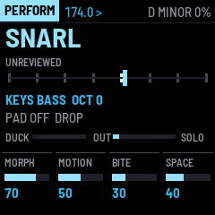

# ABYSS ENGINE

ABYSS ENGINE is the bass half of JUNGLE OS, a drum & bass live rig of two M-VAVE FM-1s. Its neuro bass (FM CREATURE, REESE MATRIX) moves through a curated graph of ten sweetspot sounds with MORPH, SNAP, EXPLORE, MUTATE and REVERT, so it is played rather than programmed. A separate clean mono sub stays below it, untouched by width or distortion. There are rave, orchestral, glass and dark stabs, a four-voice evolving pad, a harmonic sequencer on a shared key with slides and locks, ducking from BREAK SURGEON's kicks, six scenes and the bass-safe NEURO PRESSURE master. It works alone, and with BREAK SURGEON on a second FM-1 over JUNGLE LINK.

Version {{VERSION}}. **Not yet tested on a physical FM-1.** It is tested in software: 124 engine checks, audio-regression renders, fm1-base's host simulator and fm1-emu, an instruction-level emulator that runs the real firmware file. Installing it is at your own risk; the installer can put M-VAVE's own firmware back. Back up first.

- [Try it in the browser](emu/): the same code the FM-1 runs, with sound and Web MIDI. No FM-1 needed.
- [Manual](manual/): every page, button and key.
- [Install](install/): from Chrome or Edge, with the FM-1 connected by USB.
- [Download {{PKG}}](firmware/{{PKG}}): for the command-line installer, `python3 base/tools/fm1_install.py {{PKG}}`.
- [BREAK SURGEON](../break-surgeon/), the rhythm half, and [JUNGLE OS](../), both together.
- [Source code on GitHub](https://github.com/RahelPuest/jungle-os-fm1).

Built on fm1-base and felucca-bsp (MPL-2.0). ABYSS ENGINE is MPL-2.0. It is not affiliated with or endorsed by M-VAVE; M-VAVE and FM-1 are trademarks of their owners.
