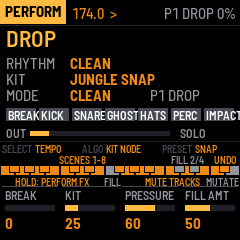
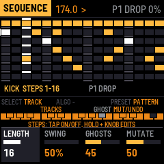
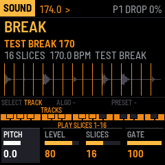
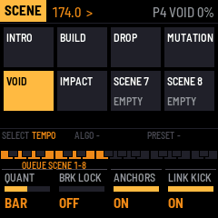

# The BREAK SURGEON manual

BREAK SURGEON plays sliced breakbeats and six synthesized drum models on one sequencer, for 160–190 BPM jungle and
drum & bass. Status: it runs in the simulators and the browser emulator; **it has not been tested on an FM-1 yet**
([docs/research/compatibility-matrix.md](https://github.com/RahelPuest/jungle-os-fm1/blob/main/docs/research/compatibility-matrix.md)).

## Quick start: eight moves for a set

1. **PLAY** starts the groove: pattern P1 DROP, the built-in break, a two-step kick and the backbeat.
2. **K1 BREAK** turns the break from CLEAN through ROLLING and CHOPPED to GLITCHED. **K2 KIT** changes the whole
   kit's character.
3. **Hold white keys 1–7** for the performance effects: ROLL, ROLL 32, CHOP, REVERSE, GLITCH, DESTROY, FREEZE. Let go
   and it stops.
4. **ENV** plays a fill from the next bar. **SEL + ENV** plays a 2-bar fill.
5. **REC** is RETURN: back to the clean groove at the next bar, whatever you did.
6. **LFO** mutates the break. **SEL + LFO** undoes it.
7. **SEL + white 1–8** queues scene 1–8 (INTRO, BUILD, DROP, …). **SAVE + white 1–8** stores the current state there.
8. **White keys 9–15** mute BREAK, KICK, SNARE, GHOST, HATS, PERC, IMPACT.

You don't have to remember any of this: the screen shows, on every page, what each key and each encoder does.

The same buttons do the same things on ABYSS ENGINE: PLAY, REC (RETURN), ENV (FILL), LFO (MUTATE, SEL + LFO undo),
SEL + white (scenes), SAVE + white (store a scene), SEL + black (mute), SEL + PLAY (panic).

## The screen

From top to bottom:

- **The header:** the page, the tempo, `>` playing or `#` stopped, the pattern, the scene and the audio load (red
  line: overload or a dropout). A white bar along its bottom edge fills up while a pattern, a scene, a fill or
  RETURN waits for its bar. It lands when the bar is full.
- **The page.**
- **The strip:** a line saying what the SELECT, ALGO and PRESET encoders do on this page, then a small picture of
  the 27 keys. Each run of keys is coloured and labelled with what it does: the black keys' labels above, the white
  keys' below. **Hold SEL** (the emulator's panel draws it SCL) or **SAVE**, and the strip changes to what the keys
  and encoders do with that button held. With SEL held, the bottom of the page also lists the SEL button
  combinations.
- **The four K-knob boxes:** name, value bar, value. The box you are turning lights up.

Below, *white 1..16* are the white keys left to right (F3 … G5), *black 1..11* the black keys left to right.

## Buttons (every page)

| Button | Tap | With SEL held |
|---|---|---|
| HOME | PERFORM page | |
| SEQ | SEQUENCE page | |
| EDIT | SOUND page | |
| FX | FX page (DRUM PRESSURE) | |
| ARP | SCENE page | |
| GLO | SYSTEM page | |
| PLAY | start / stop | **PANIC**: stop, cut every voice, clear performance modes |
| REC | **RETURN**: back to the stable groove at the next bar (performance modes, fill and rhythm graph off) | |
| ENV | **FILL** from the next bar, 1 bar | a 2-bar fill |
| LFO | **MUTATE** the break (amount: SEQUENCE page K4) | **UNDO** the last mutation |
| SAVE | save patterns, scenes and settings (refused while playing: a flash write stalls the audio) | |
| OCT− / OCT+ | SEQUENCE: steps 1–16 / 17–32. Elsewhere: previous / next pattern at the next bar | |
| SEL | a modifier; while held, the K knobs move in fine steps | |

**On every page:** SEL + white 1–8 queues scene 1–8; SAVE + white 1–8 stores the current state as scene 1–8;
SEL + black 1–7 mutes or unmutes track 1–7 (BREAK, KICK, SNARE, GHOST, HATS, PERC, IMPACT).

## The encoders

| Page | SELECT | ALGO | PRESET |
|---|---|---|---|
| PERFORM | tempo (0.5 BPM a click) | **KIT NODE**: the kit one sweetspot along (as Abyss Engine's EXPLORE) | **SNAP**: BREAK and KIT to their nearest sweetspots (as Abyss Engine's SNAP) |
| SEQUENCE | the track (SEL + SELECT: tempo) | a held step's slice (BREAK) or tune lock (drums) | the pattern, at the next bar |
| SOUND | the track (SEL + SELECT: tempo) | PERC's voice: TOM, RIM, SHAKER, CLICK | the drum's level |
| FX | tempo | the bus preset | **ROOM**; SEL + PRESET: the output trim |
| SCENE, SYSTEM | tempo | — | SYSTEM: the USB port as a host |

## PERFORM (HOME)

The screen shows the scene (and the queued one), the rhythm and kit sweetspots the BREAK and KIT knobs are nearest,
the mode, the pattern, the seven mutes, the output meter, and LINK OK or SOLO.

| Control | Does |
|---|---|
| K1 BREAK | the rhythm graph: CLEAN → ROLLING → CHOPPED → GLITCHED (slice substitution, ratchets, reverse, stutter, gate, pitch drops; anchors kept) |
| K2 KIT | the kit graph: DUSTY ROLLER → JUNGLE SNAP → TIGHT NEURO → METAL TECHSTEP → INDUSTRIAL (all 16 drum macros move together, loudness trimmed) |
| K3 PRESSURE | DRUM PRESSURE's density (as on the FX page) |
| K4 FILL AMT | how wild the fills are (and how dense the generated ghosts) |
| white 1 (hold) | ROLL: the current slice repeated in 16ths |
| white 2 (hold) | ROLL in 32nds |
| white 3 (hold) | CHOP: a new slice every step (beats kept) |
| white 4 (hold) | REVERSE: every slice backwards |
| white 5 (hold) | GLITCH: chops, ratchets, stutters |
| white 6 (hold) | DESTROY: all of it harder |
| white 7 (hold) | FREEZE: a 4 ms loop of where the break is; release to let go |
| white 8 | FILL, 1 bar |
| white 9..15 | mute BREAK, KICK, SNARE, GHOST, HATS, PERC, IMPACT (lit = playing). SEL + key: solo |
| white 16 | MUTATE |
| black 1..8 | queue scene 1..8 at the SCENE page's quantization |
| black 9 / 10 | FILL 2 bars / 4 bars |
| black 11 | UNDO the last mutation |

Releasing a held mode key ends that mode at once; REC (RETURN) ends everything at the next bar.

## SEQUENCE (SEQ)

All seven tracks at once, top to bottom BREAK, KICK, SNARE, GHOST, HATS, PERC, IMPACT: 16 steps of the current
page (OCT−/OCT+), the selected track marked at the left, muted tracks struck through, the playheads above.

| Control | Does |
|---|---|
| white key (tap) | step on / off on the selected track |
| white key (hold) + K1 / K2 / K3 / K4 | that step's VELOCITY / PROBABILITY / RATCHET (1–8 hits) / MICROTIMING (±½ step) |
| white key (hold) + SEL + K1..K4 | a parameter lock of one of the track's four sound macros on that step (two locks a step). Hold the step first, then SEL |
| white key (hold) + ALGO | BREAK track: the step's slice. Drum tracks: a tune lock (¼ semitone a click) |
| white key (hold) + black 11 | HATS: open / closed. BREAK: reverse the step |
| black 1..7, SELECT | select BREAK, KICK, SNARE, GHOST, HATS, PERC, IMPACT |
| black 8 | generate the GHOST track (density: K3) |
| black 9 / 10 | MUTATE / UNDO |
| K1..K4 (no step held) | track LENGTH (1–32), SWING (50–75 %), GHOST density, MUTATE amount |
| PRESET | the pattern |

Turning a knob while a step key is held does not toggle the step when you let go.

The four patterns, all at 174 BPM and straight (swing 50 %; the feel comes from the ghosts and the microtiming):

| Pattern | |
|---|---|
| P1 DROP | the break whole, under a two-step kick (1 and the "and" of 3) and the backbeat (2 and 4), offbeat hats, ghosts |
| P2 ROLLER | the break edited (its first half again, the last snare doubled into a roll), a rolling kick, 16th shakers, more ghosts |
| P3 HALF-TIME | kick and snare at half time, the break on 8ths |
| P4 INTRO | the break thinned out, no synthesized kick or snare |

## SOUND (EDIT)

| Control | Does |
|---|---|
| black 1..7, SELECT | the track |
| white keys | audition: BREAK plays slice 1..16; a drum track plays its sound, softer at the left, harder at the right |
| K1..K4, drum tracks | the model's four macros: KICK WEIGHT PUNCH PITCH DRIVE · SNARE BODY CRACK TAIL PRESSURE · GHOST TONE SNAP DECAY SWING · HATS METAL BRIGHT LENGTH HUMAN · PERC TONE DECAY NOISE BEND · IMPACT SIZE SWEEP NOISE DIRT |
| ALGO, PERC track | the PERC voice: TOM, RIM, SHAKER, CLICK |
| PRESET, drum tracks | the drum's level |
| K1..K4, BREAK track | PITCH (±12 semitones), LEVEL, SLICES (8 / 16 / 32), GATE |

**How hard a drum is hit changes its sound, not only its level.** A harder hit is brighter, with more of the
snare's crack and the kick's beater click; a soft one is a dull tap. That is why the ghost notes (low velocities)
sit behind the snare instead of sounding like small copies of it.

The models:

- **PUNCH KICK:** a short body at 45–75 Hz (55 Hz by default; the deep sub is Abyss Engine's job) with a pitch
  sweep (PUNCH), a tonal beater click at 1.8–3.8 kHz and a noise snap on top.
- **CRACK SNARE:** a tuned body (TUNE) with a pitch drop; the stick's crack, the wires' snap and the wires' tail,
  each with its own envelope. BODY sets how much drum there is, CRACK the attack, TAIL how long the wires ring,
  PRESSURE the drive.
- **GHOST SNARE:** the same snare drum played softly: TONE is its brightness, SNAP its attack, DECAY its tail.
  SWING moves the generated ghosts late (about 8 ms at the default), the lazy feel of a drummer's ghost notes.
- **METAL HATS:** METAL low is noise, like a shaker; METAL high is the six-oscillator metallic sound. BRIGHT, LENGTH
  (open hats are longer), HUMAN (each hit a little different).
- **BREAK PERC** and **IMPACT FX** as before.

The BREAK screen shows the break's name, tempo, slice count, whether it comes from the bank or is the built-in test
break, and the waveform with the slice marks.

**The built-in test break** is an original two-step groove in the jungle manner, played as a drummer would: kicks
on 1 and the "and" of 3, snares on 2 and 4, soft and slightly late ghost snares, accented offbeat hats over an 8th
shaker. It is mixed in a small room and stored as a sampler would store it (12 bits at 22 kHz). It isn't a copy of
any recorded break; for the real thing, load your own breaks (below).

## FX (DRUM PRESSURE)

- **K1 PUNCH:** the transients, softer or harder.
- **K2 GRIT:** up to 40 % a sampler's grit in series (12 down to 10 bits, a held rate, a darker top, in the manner
  of old 12-bit samplers); above 40 % the parallel bit crush comes in as well.
- **K3 GLUE:** a fast bus compressor (0.8–4 ms attack, short release, with makeup) that pulls the hits together and
  brings the ghosts, the hats and the room up.
- **K4 PRESSURE:** saturation into its knee, together with a compensating trim. The kit gets denser, not just louder.
- **PRESET: ROOM.** A small room, fed most by the snare and its ghosts, little by the kick. It sits before GLUE, so
  it is compressed with the kit, as a break recorded in a room is. SEL + PRESET: the output trim.
- **ALGO: the presets.** CLEAN JUNGLE, ROLLING BREAKS (the default), TIGHT NEURO, CRUSHED AMEN, INDUSTRIAL.

The screen shows the peak, the glue's gain reduction, the room, the trim and the peak guard's catches. The ceiling
is −0.5 dBFS; the guard has no look-ahead, so it isn't a true-peak limiter.

## SCENE (ARP)

white 1..8: queue a scene; SAVE + white: store (both work on every page too, with SEL and SAVE). The knobs:

- **K1 QUANT:** NOW, BEAT, BAR, 2 BAR, 4 BAR.
- **K2 BREAK-LOCK:** OFF; LAYER (the synth kick and snare also play where the break plays a kick or snare slice);
  SEPARATE (they skip those steps, so nothing doubles).
- **K3 ANCHORS:** mutation and the rhythm graph keep the beats.
- **K4 LINK KICK:** send kick and snare triggers to Abyss Engine.

A scene holds the pattern, the mutes, the BREAK and KIT positions, FILL AMT and the DRUM PRESSURE settings (room
included).

## SYSTEM (GLO)

K1 BPM, K2 CLOCK (INT / MIDI in), K3 LINK CH, K4 SYNC OUT (clock and transport out). PRESET: the USB port as a host
(to host the other FM-1 over an OTG cable; unverified on hardware). The page shows the load and dropouts, the
clock, the link, the bank, the store's state ("DEFAULTS USED" when saved data did not check), queue and command
drops, the USB mode.

Version 0.2 saves its settings and scenes in a new layout (the room was added). The first start after an update
uses the defaults for them (SETTINGS DEFAULTS LOADED); the patterns are kept.

## MIDI

In: clock (`F8`, with CLOCK = MIDI), start/stop, notes 36–41 play KICK … IMPACT live (with velocity, so with their
timbre), notes 48–79 play slices 1–32. Out (USB): clock and transport (SYNC OUT), the link
([docs/architecture/link-protocol.md](https://github.com/RahelPuest/jungle-os-fm1/blob/main/docs/architecture/link-protocol.md)).

## Loading your own breaks

1. Prepare: `python3 tools/sample-prep/jo_sample_prep.py build my.bank amen_like.wav:2:16:ROLLER other.wav:1:8 --snap`
   (each input `file:bars:slices:name`; WAV or AIFF; up to 8 breaks, 241,664 bytes ≈ 5.5 s at 22 kHz in all).
2. Stop the FM-1 (not playing), connect USB, then
   `python3 tools/sample-prep/jo_send_bank.py my.bank` (needs `pip3 install mido python-rtmidi`).
3. The screen says BANK LOADED and the break's name. The bank stays across power-offs.

This is tested in fm1-base's simulator, not yet on a physical FM-1. If a transfer fails, Break Surgeon keeps
working with its built-in test break. Use only audio you have the rights to.
