# The BREAK SURGEON manual

BREAK SURGEON is a step sequencer for sliced breakbeats and six synthesized drums, for 160–190 BPM jungle and drum &
bass, with live tools on held buttons. Status: it runs in the simulators and the browser emulator; **it has not been
tested on an FM-1 yet**
([docs/research/compatibility-matrix.md](https://github.com/RahelPuest/jungle-os-fm1/blob/main/docs/research/compatibility-matrix.md)).

**The one rule (0.5):** a **tap** on a button opens a page or does its action; **holding** a button is a layer for
as long as you hold it: the keys and knobs change, the screen says what they do, and letting go is always safe.

## Quick start: eight moves for a set

1. **PLAY** starts pattern P1. The main page shows the selected track's 16 steps big, every track below as a thin row.
2. **Black keys 1–7** pick the track (BREAK, KICK, SNARE, GHOST, HATS, PERC, IMPACT). **White keys** are its steps:
   tap one on or off.
3. **ALGO** loads a groove (2-STEP, STEPPA, HALF-TIME …) into the pattern, the break re-chopped to it.
4. **Hold FX** and hold white keys 1–8: ROLL, ROLL 32, CHOP, REVERSE, GLITCH, DESTROY, FREEZE, TAPE STOP.
5. **Tap ENV**: a fill at the end of the phrase. **Hold ENV** + white 1–4: a ROLL, SNARE BUILD, DROP OUT or CHOP
   fill from the next bar.
6. **Hold LFO** + white 1–4: variation A–D (the patterns P1–P4); + white 9–14: a FORM that plays them bar by bar
   (A B A C …).
7. **Hold ARP** + white 1–8: queue scene 1–8; white 9–12: pattern P1–P4; black keys: mute.
8. **SEL + LFO** undoes anything (SEL + ENV redoes it): steps, grooves, mutations, recordings, erasing.

**Tap REC** and play the white keys to record the track live (soft at the left, hard at the right); tap REC again
to stop. **Hold REC** and press a white key to clear that step.

The same buttons do the same things on ABYSS ENGINE.

## The screen

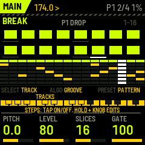

From top to bottom:

- **The header:** the page (or the held layer), the tempo, `>` playing or `#` stopped, then REC while recording,
  the pattern (P1 … P4, or A … D while a FORM plays; `*` = a change is queued), the bar in the phrase (3/4) and the
  audio load. A white bar along the header's bottom edge fills up while a pattern, a scene, a fill or RETURN waits
  for its moment.
- **The page.** While a layer button is held, the page shows the layer instead: a banner with its name, and what each
  white key does, the active one lit.
- **The strip:** what SELECT, ALGO and PRESET do now, then the 27 keys, each run labelled with what it does (black
  keys above, white below). In a layer it names the layer (FX HELD …).
- **The four K-knob boxes:** name, value bar, value. The box you are turning lights up.

Below, *white 1..16* are the white keys left to right (F3 … G5), *black 1..11* the black keys left to right.

## Buttons

| Button | Tap | Hold: a layer while held |
|---|---|---|
| HOME | the main page | — |
| SEQ | the overview: all tracks with names, lengths, swing | — |
| EDIT | SOUND: the track's sound; the keys audition it | — |
| FX | the FX page (DRUM PRESSURE) | **FX**: white 1–8 the performance FX while held; K1–K4 PUNCH GRIT GLUE PRESSURE |
| ARP | SONG: scenes, FORM, phrase, quantize | **SONG**: white 1–8 queue a scene, white 9–12 a pattern, black 1–7 mute / unmute |
| GLO | SYSTEM | — |
| ENV | a ROLL fill in the phrase's last bar (or its last 2) | **FILL**: white 1–4 ROLL, SNARE BUILD, DROP OUT, CHOP from the next bar; K1 the length (1 or 2 bars) |
| LFO | MUTATE the selected track | **VARY**: white 1–4 variation A–D, white 9–14 the FORM; K1 DENSITY, K2 HUMANIZE, K3 MUTATE amount, K4 GHOSTS |
| REC | RECORD on / off | **ERASE**: white = clear that step, black = clear that track |
| SAVE | save everything (refused while playing; it also saves by itself 3 s after STOP) | **STORE**: white 1–8 store the current state as scene 1–8 |
| SEL | — | **SEL**: + LFO UNDO, + ENV REDO, + PLAY PANIC, + REC RETURN, + SELECT tempo, + a knob fine steps |
| PLAY | start / stop | |
| OCT− / OCT+ | steps 1–16 / 17–32 | |

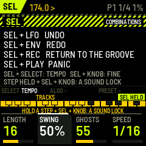

## The keys and encoders

On every page but SOUND, and when not recording:

| Control | Does |
|---|---|
| white 1–16 | the selected track's steps: tap on / off; hold one and turn a knob or an encoder to edit it |
| black 1–7, SELECT | the track: BREAK, KICK, SNARE, GHOST, HATS, PERC, IMPACT |
| ALGO (main page, overview) | **GROOVE**: the next / previous groove into the pattern (below) |
| PRESET (main page, overview, SOUND) | the pattern P1–P4: at the next bar, or at the phrase's end with QUANT = PHRASE |
| step held + K1 / K2 / K3 / K4 | VELOCITY / PROBABILITY / RATCHET (1–8 hits) / MICROTIMING (±½ step) |
| step held + SEL + K1..K4 | a lock of one of the drum's four sound macros on that step (two locks a step) |
| step held + ALGO | the step's **trig condition** (below) |
| step held + PRESET | BREAK: the step's slice. Drums: a tune lock (¼ semitone a click) |

A held step shows a box with all its values: the condition, the slice or tune, velocity, probability, ratchet and
microtiming. In the big steps a blue corner marks a lock, a red one a condition, a grey dot a probability under
100 %, a white line an open hat (HATS) or a reversed slice (BREAK).

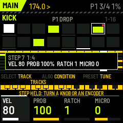

## The main page (HOME)

The selected track's 16 steps big (velocity as the bar in each box, the playhead under it), the pattern or groove's
name, and all seven tracks as thin rows below (muted ones struck through). The knobs are the track's sound:

- **BREAK:** PITCH (±12 semitones), LEVEL, SLICES (8 / 16 / 32), GATE.
- **The drums:** the model's four macros: KICK WEIGHT PUNCH PITCH DRIVE · SNARE BODY CRACK TAIL PRESSURE · GHOST TONE
  SNAP DECAY SWING · HATS METAL BRIGHT LENGTH HUMAN · PERC TONE DECAY NOISE BEND · IMPACT SIZE SWEEP NOISE DIRT.

## The overview (SEQ)

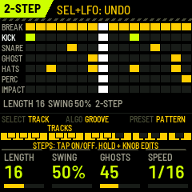

Every track's 16 steps with its name. K1 LENGTH (1–32) of the selected track, K2 SWING (50–75 %), K3 GHOSTS
(generates the GHOST track, denser to the right), K4 SPEED (1/16, 1/32, 1/8). ALGO is the groove library here too.

## The performance FX (hold FX)

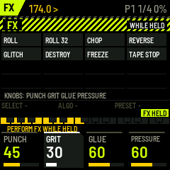

White 1–8 while held: **ROLL** (the slice playing now, repeated in 16ths), **ROLL 32**, **CHOP**, **REVERSE**,
**GLITCH**, **DESTROY**, **FREEZE** (a tiny loop of the sound), **TAPE STOP** (the drums stop, the break slows to a
standstill over 0.7 s). Letting go of the key, or of FX, ends it. K1–K4 are DRUM PRESSURE's PUNCH, GRIT, GLUE,
PRESSURE.

## Fills (ENV)

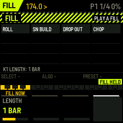

- **Tap ENV:** a ROLL fill in the last bar of the phrase (with LENGTH 2: its last two bars), so it leads into the
  next phrase. Tapped in the last bar, it goes to the next phrase's end.
- **Hold ENV + white 1–4:** from the next bar:
  - **ROLL:** the break chops up more and more, the snare rolls in the second half, a gap before the drop.
  - **SNARE BUILD:** the snare on every 16th, louder and louder, ratchets at the end; the kick out.
  - **DROP OUT:** break, kick, snare and ghosts out, the hats left; the impact lands on the drop.
  - **CHOP:** the break cut up hard, ratchets and reverses, the drums as they are.
- **K1** (ENV held): the length, 1 or 2 bars. SOUND's FILL AMT sets how hard ROLL builds.

Break Surgeon tells Abyss Engine over the link in the bar before the fill, so its bass rolls with it.

## Variations and FORM (LFO)

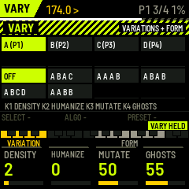

The four patterns are the variations: **A = P1, B = P2, C = P3, D = P4**.

- **Hold LFO + white 1–4:** play variation A–D from the next bar (this turns a FORM off).
- **Hold LFO + white 9–14:** the FORM: OFF, A B A C, A A A B, A B A B, A B C D, A A B B. It plays one variation a
  bar, on the 4-bar grid that both FM-1s share, so it stays in step with Abyss Engine and with the scenes.
- **The knobs, LFO held:**
  - **K1 DENSITY:** a step more or less on the selected track, a click at a time. More: the most important empty
    step first (the downbeat, then the beats, the 8ths, the 16ths). Less: the 16ths and ghosts first, the downbeat
    last.
  - **K2 HUMANIZE:** small velocity and timing offsets on the track's steps; back to 0 puts them on the grid again.
  - **K3 MUTATE:** how much a tap on LFO changes.
  - **K4 GHOSTS:** generates the GHOST track, sparse to dense.
- **Tap LFO:** MUTATE the selected track: on BREAK other slices of the same kind, on a drum track hits moved a 16th
  (the beats stay with ANCHORS on).

All of it can be undone (SEL + LFO).

## Recording (REC)

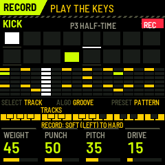

**Tap REC** (the REC light is on): the white keys now play the selected track and write what you play into the
steps, each hit to the nearest 16th. On a drum track the keys go from soft (left) to hard (right), and the hit's
velocity is written; on BREAK the keys are the slices 1–16. With the transport stopped the keys only play. Tap REC
again to stop recording. One recording pass is one undo.

**Hold REC** (the ERASE layer): a white key clears that step of the selected track, a black key clears that whole
track.

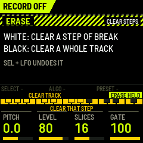

## Trig conditions

Hold a step and turn **ALGO**: when the step plays.

| Condition | Plays |
|---|---|
| ALWAYS | every time |
| 1:2, 2:2 | in the first / second bar of every 2 |
| 1:4 … 4:4 | in the first … fourth bar of every 4 |
| FILL / NO FILL | only during a fill / only when no fill plays |
| PHRASE 1ST / PHRASE END | only in the first / the last bar of the phrase |

The bars are counted from PLAY on the global grid, so both FM-1s count alike. A condition and a probability can be
on the same step.

## Undo and redo (SEL)

**SEL + LFO** undoes, **SEL + ENV** redoes, 8 steps deep: step edits, grooves, mutations, DENSITY, HUMANIZE, ghosts,
recording passes, erasing, lengths and swing. Edits of one kind made within 2 seconds count as one (a knob turned,
grooves browsed, steps tapped in a row). **SEL + REC** is RETURN: back to the clean groove at the next bar
(performance FX, fill and the rhythm graph off). **SEL + PLAY** is PANIC.

## SONG (ARP)

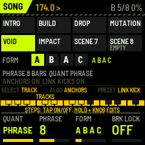

The eight scenes (the current one lit), the FORM with the bar playing lit, the phrase and the quantize.

- **K1 QUANT:** when scenes and patterns change: NOW, BEAT, BAR, 2 BAR, 4 BAR, PHRASE (the phrase's end).
- **K2 PHRASE:** 4, 8 or 16 bars: what the header counts, where ENV's tap puts its fill, PHRASE quantize and the
  trig conditions PHRASE 1ST / END.
- **K3 FORM:** as LFO + white 9–14.
- **K4 BRK LOCK:** OFF; LAYER (the synth kick and snare also play where the break plays a kick or snare slice);
  SEPARATE (they skip those steps, so nothing doubles).
- **ALGO: ANCHORS** (mutation and the rhythm graph keep the beats). **PRESET: LINK KICK** (send kick and snare
  triggers to Abyss Engine).

**Hold ARP** anywhere for the SONG layer: white 1–8 queue scene 1–8, white 9–12 pattern P1–P4 (a FORM goes off),
black 1–7 mute / unmute a track. A scene holds the pattern, the mutes, the RHYTHM and KIT positions, FILL AMT and
the DRUM PRESSURE settings. **Hold SAVE** + white 1–8 stores the current state as a scene.

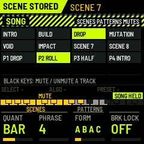

## SOUND (EDIT)

The selected track's sound in depth; the white keys audition it (BREAK: slice 1–16; a drum: softer at the left,
harder at the right). K1 **RHYTHM** turns the break from CLEAN through ROLLING and CHOPPED to GLITCHED (the rhythm
graph), K2 **KIT** the whole kit's character (the kit graph), K3 **FILL AMT** how hard ROLL fills build, K4 the
track's **LEVEL**. ALGO: the kit's next sweetspot (KIT NODE), on PERC its voice (TOM, RIM, SHAKER, CLICK). PRESET:
the pattern.

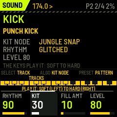

**How hard a drum is hit changes its sound, not only its level.** A harder hit is brighter, with more of the
snare's crack and the kick's beater click; a soft one is a dull tap. That is why the ghost notes (low velocities)
sit behind the snare instead of sounding like small copies of it.

The models:

- **PUNCH KICK:** a short body at 45–75 Hz (55 Hz by default; the deep sub is Abyss Engine's job) with a pitch
  sweep (PUNCH), a tonal beater click at 1.8–3.8 kHz and a noise snap on top.
- **CRACK SNARE:** a tuned body (TUNE) with a pitch drop; the stick's crack, the wires' snap and the wires' tail,
  each with its own envelope. BODY sets how much drum there is, CRACK the attack, TAIL how long the wires ring,
  PRESSURE the drive.
- **GHOST SNARE:** the same snare drum played softly: TONE is its brightness, SNAP its attack, DECAY its tail.
  SWING moves the generated ghosts late (about 8 ms at the default), the lazy feel of a drummer's ghost notes.
- **METAL HATS:** METAL low is noise, like a shaker; METAL high is the six-oscillator metallic sound. BRIGHT, LENGTH
  (open hats are longer), HUMAN (each hit a little different).
- **BREAK PERC** and **IMPACT FX**.

**The built-in test break** plays the Amen pattern, the groove of the most sampled break in jungle, at 170 BPM:
kicks on 1, the "and" of 1, the "and" of 3 and right after it; full snares on 2 and 4, lighter ones in between;
a ride on 8ths with its quarters on the bell. Each hit is synthesized by BREAK SURGEON's own drum models, mixed in
a small room and stored as a sampler would store it (12 bits at 22 kHz). It is the pattern only: no sound of the
original recording (The Winstons, "Amen, Brother", 1969) is used, as that recording is copyrighted. To play the
real break, or any other, load a recording you have the rights to (below).

## The patterns and the grooves

The four patterns at the start, all at 174 BPM and straight (swing 50 %; the feel comes from the ghosts and the
microtiming):

| Pattern | |
|---|---|
| P1 DROP | the break whole, under a two-step kick (1 and the "and" of 3) and the backbeat (2 and 4), offbeat hats, ghosts |
| P2 ROLLER | the break edited (its first half again, the last snare doubled into a roll), a rolling kick, 16th shakers, more ghosts |
| P3 HALF-TIME | kick and snare at half time, the break on 8ths |
| P4 INTRO | the break thinned out, no synthesized kick or snare |

**ALGO** on the main page or the overview loads a groove into the current pattern, one a click: the classic drum &
bass patterns. A groove writes the KICK, SNARE, GHOST and HATS tracks and the swing, and re-chops the break to it: on
every kick the break plays its nearest kick slice, on every snare its nearest snare slice, on a ghost a snare slice
played soft, in between its ride and hats. With your own bank this works from the slice classes that the
sample-prep tool writes; without them the break plays in order. PERC and IMPACT stay as they are. SEL + LFO takes
the pattern back to before the grooves you browsed.

| Groove | The pattern (16ths, 1 = the downbeat) |
|---|---|
| 2-STEP | kick on 1 and the "and" of 3, snare on 2 and 4: the backbone |
| DELAYED 2-STEP | the second snare a 16th late |
| STEPPA | kick on 1 and 3, straight 8th hats |
| EXTENDED STEPPA | two bars: the second's kick pushed, a snare pickup at the end |
| STOMPA | the kick stomping on the "and" of 2 into 3 |
| HALF-TIME | one snare a bar, on 3; hats on the quarters |
| DANCEHALL | kick on 1 and 3 under the dembow's snares |
| FOOTWORK | dotted kicks against the backbeat (the "fake triplets") |
| TRIPLET 2-STEP | the 2-step shuffled: 16th hats, swing 67 % |
| ROLLER | the 2-step with rolling ghosts and 16th hats, swing 56 % |
| JUMP UP | the kick bouncing on 3 and its "and" |
| TECHSTEP | hard and straight, the kick pushing before 4 |
| DANCEFLOOR | a kick before the second snare, ghosts ahead of the snares |
| AMEN | the break alone, in order (the built-in break is the Amen pattern) |

These are the genre's common forms written on the 16th grid; the names follow the usual names of the patterns
(STRANJAH's tutorials on YouTube teach them under these names), the grids are this firmware's own versions.

## FX (DRUM PRESSURE)

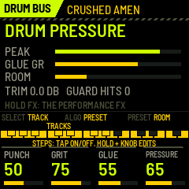

- **K1 PUNCH:** the transients, softer or harder.
- **K2 GRIT:** up to 40 % a sampler's grit in series (12 down to 10 bits, a held rate, a darker top, in the manner
  of old 12-bit samplers); above 40 % the parallel bit crush comes in as well.
- **K3 GLUE:** a fast bus compressor (0.8–4 ms attack, short release, with makeup) that pulls the hits together and
  brings the ghosts, the hats and the room up.
- **K4 PRESSURE:** saturation into its knee, together with a compensating trim. The kit gets denser, not just louder.
- **PRESET: ROOM.** A small room, fed most by the snare and its ghosts, little by the kick. It sits before GLUE, so
  it is compressed with the kit, as a break recorded in a room is. SEL + PRESET: the output trim.
- **ALGO: the presets.** CLEAN JUNGLE, ROLLING BREAKS (the default), TIGHT NEURO, CRUSHED AMEN, INDUSTRIAL.

The screen shows the peak, the glue's gain reduction, the room, the trim and the peak guard's catches. The ceiling
is −0.5 dBFS; the guard has no look-ahead, so it isn't a true-peak limiter.

## SYSTEM (GLO)

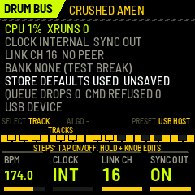

K1 BPM, K2 CLOCK (INT / MIDI in), K3 LINK CH, K4 SYNC OUT (clock and transport out). PRESET: the USB port as a host
(to host the other FM-1 over an OTG cable; unverified on hardware). The page shows the load and dropouts, the
clock, the link, the bank, the store's state ("DEFAULTS USED" when saved data did not check), queue and command
drops, the USB mode.

**Saving.** SAVE saves the settings, the four patterns and the scenes; while playing it is refused, since a flash
write stalls the audio. 3 seconds after STOP (or after your last change while stopped) Break Surgeon saves by itself
(AUTOSAVED). Version 0.5 saves in a new layout (trig conditions, the phrase, the FORM): the first start after the
update uses the default settings (SETTINGS DEFAULTS LOADED) and the factory patterns; the scenes are kept.

## MIDI

In: clock (`F8`, with CLOCK = MIDI), start/stop, notes 36–41 play KICK … IMPACT live (with velocity, so with their
timbre), notes 48–79 play slices 1–32. Out (USB): clock and transport (SYNC OUT), the link
([docs/architecture/link-protocol.md](https://github.com/RahelPuest/jungle-os-fm1/blob/main/docs/architecture/link-protocol.md)).
A scene queued with QUANT = PHRASE goes over the link as 4 BAR (the link knows bars up to 4).

## Loading your own breaks

1. Prepare: `python3 tools/sample-prep/jo_sample_prep.py build my.bank amen_like.wav:2:16:ROLLER other.wav:1:8 --snap`
   (each input `file:bars:slices:name`; WAV or AIFF; up to 8 breaks, 241,664 bytes ≈ 5.5 s at 22 kHz in all).
2. Stop the FM-1 (not playing), connect USB, then
   `python3 tools/sample-prep/jo_send_bank.py my.bank` (needs `pip3 install mido python-rtmidi`).
3. The screen says BANK LOADED and the break's name. The bank stays across power-offs.

This is tested in fm1-base's simulator, not yet on a physical FM-1. If a transfer fails, Break Surgeon keeps
working with its built-in test break. Use only audio you have the rights to.
