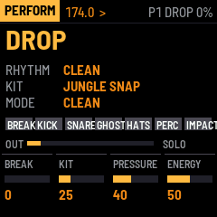

# BREAK SURGEON

BREAK SURGEON is the rhythm half of JUNGLE OS, a drum & bass live rig of two M-VAVE FM-1s. It plays sliced breaks and six synthesized drum models (PUNCH KICK, CRACK SNARE, GHOST SNARE, METAL HATS, BREAK PERC, IMPACT FX) on one sample-accurate 7-track sequencer with velocity, probability, ratchets, microtiming, swing and parameter locks. On top of that: fills that return cleanly, ghost-note generation, mutation with anchors and undo, BREAK-LOCK, seven held performance modes (ROLL, CHOP, REVERSE, GLITCH, DESTROY, FREEZE) with RETURN, sweetspot graphs for the rhythm and the kit, six scenes and the DRUM PRESSURE master bus. It works alone, and with ABYSS ENGINE on a second FM-1 over JUNGLE LINK.

New in 0.3.1: the built-in break plays the Amen pattern at 170 BPM, synthesized from BREAK SURGEON's own drums (the pattern only, not the copyrighted 1969 recording).

New in 0.2: a drum & bass kit. The kick is short and punchy at 55 Hz with a beater click. The snare has a body, a crack, a snap and a tail, and the ghosts are that snare played softly, a little late. Every drum's tone follows how hard it is hit. DRUM PRESSURE adds a room, a sampler's 12-bit grit and a glue that makes the kit denser instead of quieter. The controls are the same as ABYSS ENGINE's, and the screen shows what every key and encoder does, also with SEL or SAVE held.

Version {{VERSION}}. **Not yet tested on a physical FM-1.** It is tested in software: 124 engine checks, audio-regression renders, fm1-base's host simulator and fm1-emu, an instruction-level emulator that runs the real firmware file. Installing it is at your own risk; the installer can put M-VAVE's own firmware back. Back up first.

- [Try it in the browser](emu/): the same code the FM-1 runs, with sound and Web MIDI. No FM-1 needed.
- [Manual](manual/): every page, button and key.
- [Install](install/): from Chrome or Edge, with the FM-1 connected by USB.
- [Download {{PKG}}](firmware/{{PKG}}): for the command-line installer, `python3 base/tools/fm1_install.py {{PKG}}`.
- Earlier versions: [0.3.0](firmware/breaksurgeon-0.3.0.fwsc) (the synthetic two-step break), [0.2.0](firmware/breaksurgeon-0.2.0.fwsc) (the 0.2 screens), [0.1.0-dev](firmware/breaksurgeon-0.1.0-dev.fwsc) (the first kit and controls).
- [ABYSS ENGINE](../abyss-engine/), the bass half, and [JUNGLE OS](../), both together.
- [Source code on GitHub](https://github.com/RahelPuest/jungle-os-fm1).

The FM-1 has no audio input: breaks are prepared on a computer (`tools/sample-prep/jo_sample_prep.py`) and sent over USB as a sample bank. Without a bank it plays its built-in test break. Use only audio you have the rights to.

Built on fm1-base and felucca-bsp (MPL-2.0). BREAK SURGEON is MPL-2.0. It is not affiliated with or endorsed by M-VAVE; M-VAVE and FM-1 are trademarks of their owners.
